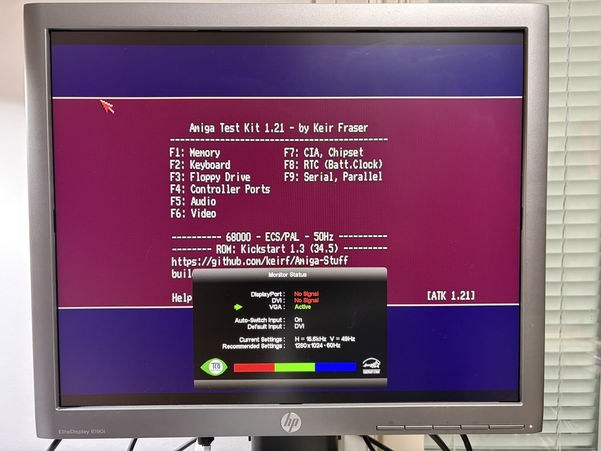

# rtd_15khz_patch

Make some Realtek-based LCD monitors accept 15 kHz video (240p / 288p), by lowering the input frequency limits in the monitor's own firmware.

The script patches a **copy of a dump of your own monitor's firmware**. No firmware is distributed here.



*Patched HP EliteDisplay E190i: Amiga 600 (PAL, 15.6 kHz) on VGA, shown at 4:3 with `--aspect43`.*

## Confirmed results

| Monitor | Scaler | Result |
|---|---|---|
| HP EliteDisplay E190i | Realtek | Patched. VGA: an Amiga 600 (15.6 kHz, 50 Hz PAL) shows a clean picture with no warning box, all menus work, and auto adjust works like with a PC. DisplayPort: 15.7 kHz / 59 Hz 240p from a RetroScaler2x with its line doubling off, through an HDMI-DisplayPort adapter (before the patch it needed the scaler's 2x mode). DVI: HDMI sources through a passive HDMI-DVI adapter (Ultimate64 in HDMI mode, RetroScaler2x) now work; unpatched they gave "No Input Signal". `--wide400` and `--smooth400` confirmed working: 320x200 DOS games look clean, text mode crisp or smoothed. `--aspect43` confirmed working. `--manual-auto` confirmed: no automatic auto adjust on new modes. |
| Lenovo ThinkVision LT1913p | Realtek | Accepts 15 kHz out of the box, nothing to patch. Amiga 600 on VGA works without any warning box. The script can also apply `--wide400` and `--aspect43` to its firmware, but the patched image could not be flashed: the flash chip is write protected (see Flash chip notes). |

Other monitors may or may not have the same code. The script only changes a firmware when it finds the exact patterns it expects, and stops otherwise.

## Why it works

These firmwares have an input range check that rejects any signal below a minimum horizontal frequency. On the HP E190i that minimum is 23.5 kHz, on the ThinkVision LT1913p it is 10.0 kHz. On the HP the checks apply to both the DisplayPort and the VGA input. Both firmwares already contain 15.7 kHz entries (240p and 288p) in their VGA mode tables, so lowering the limit is the main fix on the HP.

The HP also has a second, softer check: a signal that passes the range check but is "not recommended" is shown anyway, with a flag set. While that flag is set the OSD keeps popping up "Input Signal Out of Range / Current Settings / Change Settings to 1280 x 1024 - 60Hz" over the working picture, and every menu except the input menu is locked. A 15 kHz VGA signal ended up on that path. The script removes it, so such signals go through the normal check and are treated as fully supported. That normal check rejects any signal the hardware flags as interlaced on VGA and DVI, which DisplayPort does not do, so the script also gives VGA and DVI the DisplayPort rule: interlaced is fine as long as the full frame fits the panel (2 x Vtotal up to 1024 lines).

The script:

1. Checks the dump size and detects wrapped reads (a programmer set to the wrong chip size).
2. Finds the range checks by instruction pattern and sets the minimum H frequency to 10.0 kHz.
3. Where the same code has a minimum V frequency, sets it to 23.0 Hz, so 50 Hz modes are not rejected by a small margin. The HP E190i has two such V limits at 49.5 Hz; the ThinkVision uses 23.0 Hz for both.
4. Where it finds the "accept but warn" path, disables it and relaxes the VGA/DVI interlace rule as described above. Both are found by instruction pattern; on the ThinkVision they are not present and nothing is changed.
5. Where the DVI input drops HDMI sources, makes it handle them as DVI (see below).
6. Lists the 15 kHz entries in the mode table.
7. With `--wide400` or `--smooth400`: fixes how 320x200 DOS games (and other 70 Hz 400-line modes) are sampled, so the picture is no longer wrongly stretched (see below).
8. With `--aspect43` (HP E190i and ThinkVision LT1913p): shows modes below 960 lines at 4:3 instead of stretched to the 5:4 panel (see below).
9. With `--manual-auto` (HP E190i only): VGA auto adjust runs only when you ask for it, not by itself whenever a new mode appears (see below).

### 320x200 DOS games and text mode (`--wide400`, `--smooth400`)

On a VGA card, DOS text mode (720x400) and the 320x200 games mode (shown as 640x400, each pixel doubled) send exactly the same sync frequencies: 31.5 kHz and 70 Hz. The monitor tells modes apart only by these frequencies, so it cannot see which one it gets. The HP firmware always assumes text mode. It samples each line as 720 pixels, with a sampling clock set for text mode's 900-pixel line length.

A 320x200 game has an 800-pixel line length, though, so that sampling clock does not fit the signal. Its 640 pixels end up spread over the wrong number of samples, and the scaler then stretches 720 samples to the panel's 1280 pixels. The result is a wrongly stretched picture with uneven pixel widths.

`--wide400` changes the firmware's 720x400 / 70 Hz mode entry to sample each line 1280 pixels wide, with a line length of 1600. 1600 is exactly 2 x 800, so every game pixel gets exactly 4 samples (2 per 640-mode pixel). 1280 is the panel width, so there is no horizontal scaling at all. The picture is sharp and even, and every 320x200 pixel is exactly 4 panel pixels wide. The start position is taken from the firmware's own 640x400 entry, doubled.

The trade-off is text mode. Its 900-pixel line length does not divide evenly into 1600, so text mode characters become slightly uneven in width. They stay readable, but they are not perfect.

`--smooth400` is the alternative for text: the line is sampled 1440 wide (line length 1800). That is exactly 2 samples per text mode pixel, so text is sampled evenly. The scaler then shrinks 1440 to 1280, and its scaling filter gives text and games a slight, even smoothing. Games get 4.5 samples per 320x200 pixel and look slightly soft but fine. Use `--wide400` for the crispest games, or `--smooth400` for nicer text. (Sampling 960 wide was also tried: games were fine, but text looked worse than ever, because 1.33 samples per text pixel is too few.)

In the Realtek reference code, the OSD Sharpness setting selects the scaling filter, which is only used when the picture is scaled. So with `--wide400` it should make no horizontal difference in the 400-line mode, and with `--smooth400` it should. (Not tested on the HP.)

The same entry covers both modes, because the monitor cannot tell text mode and 320x200 apart. The VGA BIOS also starts the horizontal sync one character earlier in mode 13h than in text mode, so after auto adjust in one of them, the other sits a few pixels off. That comes from the VGA card; set the position for the mode you use most, or halfway between.

Combined with `--aspect43` (with either option), the 400 lines are also scaled to 960, so a 320x200 game fills a 1280x960 area. That is 4:3 with square pixels, the shape DOS games were drawn for.

### 4:3 instead of 5:4 (`--aspect43`)

A 1280x1024 panel is 5:4, so 4:3 sources (240p/288p, 480p, 576p, the DOS 400-line modes) normally look slightly too tall. With `--aspect43`, any mode with fewer than 960 lines is scaled to 1280x960, with 32 black lines at the top and 32 at the bottom. Native 1280x1024 is unchanged. Neither monitor has an aspect ratio menu, so this is always on.

These scalers have no frame buffer: the panel still needs all 1024 lines every frame, at the pace of the input. A 960-line picture therefore only fits when the input has enough blank lines between frames. The firmware checks this for each mode and keeps the full 1280x1024 picture when it does not fit: 800x600 at 60 Hz, 1024x768, and 640x480 at 75 Hz. Everything at 15 kHz, 640x480 at 60 Hz, 720x480 / 720x576 and the 70 Hz 400-line modes get 4:3.

### Auto adjust only on request (`--manual-auto`, HP E190i)

On VGA, the HP runs auto adjust by itself. It keeps settings (position, clock, phase) for up to 16 modes, and each record has an "auto adjust still needed" flag. The flag is set when a mode is seen for the first time, and when an old record is replaced because all 16 are in use. Every time a VGA picture comes up with that flag set, auto adjust runs on whatever is on the screen. The flag is cleared only when auto adjust succeeds, so a run that fails is repeated at every resync of that mode.

Retro sources are a poor target for this. A dark screen, a DOS prompt, an EGA game or a 15 kHz picture with wide black borders has no clear edges to measure, so auto adjust often picks a wrong position or clock. If the run "succeeds", the wrong values are saved for that mode; if it fails, it runs again on the next mode change.

With `--manual-auto`, the monitor never starts auto adjust by itself. New modes start from the firmware's default values for that timing. Auto adjust from the front-panel button, the menu and the DDC/CI "auto setup" command (`ddcutil setvcp 1E 1`) work as before, and their results are still saved. Run it while a bright full-screen picture is showing. Settings that were saved wrong earlier stay until you adjust that mode again.

The change is 3 bytes: the call that asks "does this mode still need auto adjust?" is replaced with "no". The factory reset still runs auto adjust once on VGA.

### HDMI sources on the HP's DVI input

HDMI sources (anything that sends HDMI audio or info packets, even through a passive HDMI-DVI adapter) were not detected on the HP's DVI input. The receiver noticed the HDMI packets and the firmware then reported the input as "HDMI", an input type the rest of the HP firmware has no handling for, so after a few seconds it gave up with "No Input Signal". The ThinkVision's firmware, built from the same Realtek code, does handle that type. The script makes the HP treat these streams as plain DVI. Video only: the HP has no speakers, and HDMI audio is ignored. Found by reading the scaler's registers live with `--ddc-debug` and `ddc_probe.py` (below).

## Live debugging over DDC/CI (HP E190i)

`--ddc-debug` adds a DDC/CI code (VCP 0xE0) to the firmware: setting it to an address and then reading it returns the byte at that address, which includes the scaler's own registers. The monitor keeps working normally, and it answers on the VGA port's DDC lines whichever input is selected. `ddc_probe.py` does the I2C side with only Python 3 and Linux `/dev/i2c-*` (no extra packages):

```
sudo modprobe i2c-dev
sudo python3 ddc_probe.py list                      # find the VGA bus (e.g. "i915 gmbus vga")
sudo python3 ddc_probe.py scan 1                    # expect 0x37 (DDC/CI), 0x4A, 0x50
sudo python3 ddc_probe.py peek 1 0x02A4 0x02CB      # read scaler registers once
sudo python3 ddc_probe.py watch 1 0x02A4 0x02A7 0x02CB   # print whenever one changes
```

Useful registers: `0x02A4` DVI receiver lock status (`F8`/`F0` = locked), `0x02A7` bit 7 = DE-only mode, `0x02CB` bit 0 = HDMI stream detected. Some scaler registers are data ports where a read moves an internal pointer, so only read registers you know.

## What you need

- A Raspberry Pi (or another Linux machine with I2C) and a Realtek flash tool that works over the monitor's DDC pins, for example [rtd266x_programmer](https://github.com/bleughb/rtd266x_programmer).
- A cable to the monitor. On the HP E190i, reading and flashing worked from the Pi's HDMI port through an HDMI-DVI adapter into the monitor's DVI input, using I2C bus 2 (`-d 2`). The Pi's HDMI I2C bus has to be enabled first; see your flash tool's instructions.
- Python 3.
- Recommended: [`tools/rtd266x_programmer.patch`](tools/rtd266x_programmer.patch) for the flash tool. It adds the MX25L4005 / MX25L2005 chip entries, refuses to erase a write-protected chip, and reports whether the written data matches. Apply it in a clone of the tool with `patch -p1 < rtd266x_programmer.patch`, then `make`.

The monitor does not need to be opened.

## Steps

1. **Read the firmware twice** and compare. Two identical reads mean the connection is reliable.
   ```
   ./rtd_prog -d 2 -b orig1.bin
   ./rtd_prog -d 2 -b orig2.bin
   md5sum orig1.bin orig2.bin
   ```
   Keep this dump safe. It is your only way back.

2. **Analyse** without writing anything:
   ```
   python3 rtd_15khz_patch.py orig1.bin
   ```

3. **Write the patched copy:**
   ```
   python3 rtd_15khz_patch.py orig1.bin -o patched.bin
   ```
   Add `--wide400` or `--smooth400` for 320x200 games and DOS text, `--aspect43` for 4:3 pictures, and `--manual-auto` to stop automatic auto adjust.

4. **Flash** `patched.bin`, then **read it back** and compare with `patched.bin`.

5. **Power the monitor fully off** so it starts the new firmware: pull the mains plug **and** disconnect all video cables (HDMI/DVI, DisplayPort, VGA). Pulling only the mains plug is not enough: the scaler gets a little power through the video cables (for example the +5 V line of an HDMI-DVI cable from a Pi) and may not do a clean restart. The flash tool also leaves the scaler in programming mode, which only a full power-off clears. Wait a few seconds, then reconnect.

6. Feed it a 15 kHz signal and check the monitor menu: it should show H = 15.7 kHz. On the HP E190i there should be no "Input Signal Out of Range" box, and all menus should open.

If the monitor seems dead or stuck after flashing, first do the full power-off from step 5: it can look bricked when it is not (see Flash chip notes). If it really misbehaves, flash your original dump back. The I2C route should keep working as long as the scaler starts.

## Flash chip notes

- **Check the chip size.** The flash tool must know the right size of your flash chip. If the second half of your dump is identical to the first, the size is too big and the read wrapped around. The script warns about this and can use the first half with `--trim`. Fix the size in the tool before writing.
- In some copies of `rtd266x_programmer` the MX25L4005 (JEDEC ID `0xC22013`) is listed as 1024 KB. It is a 4 Mbit chip, so the entry should be 512 KB:
  ```c
  {"MX25L4005"  , 0xC22013,      512,       256, 64},
  ```
- The ThinkVision LT1913p uses an MX25L2005-class chip (JEDEC ID `0xC22012`, 256 KB), which may be missing from the tool's table:
  ```c
  {"MX25L2005"  , 0xC22012,      256,       256, 64},
  ```
- If a write seems to finish but the read-back still shows the old content, the flash's write protection bits may be set.
- The ThinkVision LT1913p's flash is locked at the factory (status register `0xFC`: the status register lock bit and all protection bits set). The chip's WP# pin is driven by the scaler's MCU port 8.1, and it can be raised over the same I2C connection through register `0xD7`, which unlocks the status register. Writing still failed: as soon as a page program started, the scaler's programming hardware set the protection again (`0xFC`), even with the status register locked and WP# low, and nothing was written. (The monitor's firmware is halted while the flash tool is connected, so it was not the firmware.) Not solved over I2C; an external SPI programmer with a clip on the flash chip (monitor unplugged) should work. Every write was refused, so the firmware stayed intact.
- **It can look bricked when it is not.** After reading or writing, the scaler stays in programming mode: the tool never switches it back, and its processor stays halted. In that state the buttons and even the power button do nothing, the monitor does not react to new signals, and the picture can freeze or show stray colour bars. Pulling only the mains plug may not help, because the scaler stays partly powered through the video cables (for example the +5 V line of an HDMI-DVI cable from a Pi). Pull the mains plug **and** disconnect every video cable, wait a few seconds, and reconnect before concluding anything. Even if the firmware really is broken, the flash tool can usually still reach the chip, so you can write your original dump back.

## Limits

- Lowering the firmware limit does not guarantee that a monitor's hardware can lock onto 15 kHz.
- Picture position may need adjusting in the monitor menu.
- Interlaced 480i / 576i was not tested.
- HP E190i DVI input with HDMI sources: works after patching (video only). Before the patch, workarounds were setting the Ultimate64's video output to DVI, or an active HDMI-DisplayPort adapter.
- HP E190i DisplayPort with the RetroScaler2x at 15 kHz: sometimes not detected at first. Switching the RetroScaler to 2x and back makes it appear.

## Disclaimer

No warranty. Flashing modified firmware can leave a monitor without a picture. You do this at your own risk.

## License

The scripts, documentation and photo in this repository are released under [CC0 1.0](LICENSE) (public domain dedication). This covers only what is in this repository: monitor firmware is copyrighted by its makers and is not included.
